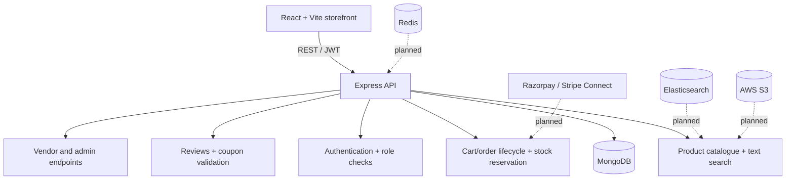

# FS-01 — Multi-vendor Marketplace Architecture

## Security and data handling
- Passwords are hashed with bcrypt.
- Signed JWTs protect customer, vendor, and admin routes.
- Product mutations are owner-scoped for vendors; admin role can manage all products.
- Request schemas validate product/order inputs.
- Stock is reserved with conditional MongoDB updates; prior reservations are rolled back if a later line cannot be reserved or order creation fails.
- The demo payment endpoint only updates a clearly labeled simulation status. It is not a real payment integration.

## Current limitations
Product search uses MongoDB text indexes, not Elasticsearch. Redis caching, S3 upload, split payments/commission accounting, PDF invoices, and a complete admin dashboard are not wired in this implementation.
