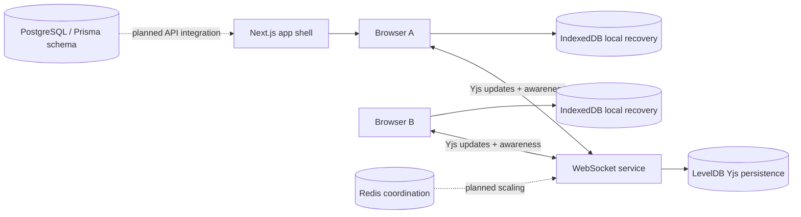

# FS-02 — Collaborative Workspace Architecture

- Yjs CRDT updates merge concurrent document changes.
- `y-websocket` transports updates and awareness state between clients.
- Awareness exposes participant names/colors and cursor offsets in the collaborator list.
- `y-indexeddb` retains a local browser copy for recovery.
- `y-leveldb` is configured as server-side document persistence.
- The Prisma schema describes users, workspaces, memberships, documents, comments, and snapshots, but the application routes for those entities are not yet connected.

## Current limitation
The editor is a collaborative plain-text editor, not a TipTap/ProseMirror rich-text editor. Presence shows connected collaborators but does not yet render remote caret decorations inside the text area. Permissions, comments, and version-history UI remain to be implemented.
